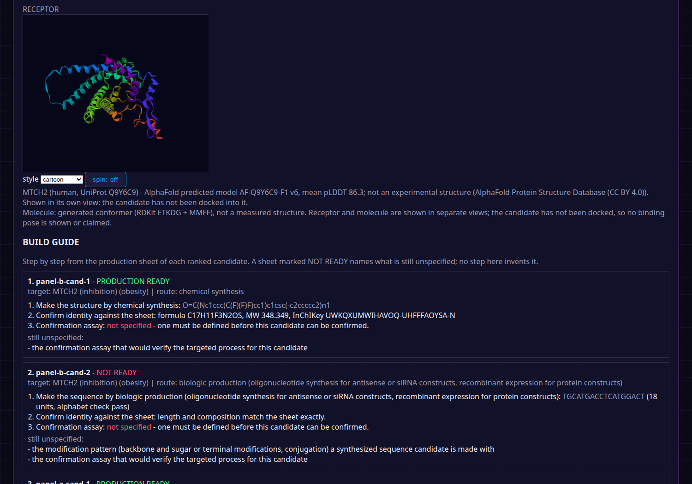

```
            O
            ||
      C-----C
     /       \
   C           C----N
     \       /
      C-----C
            |
            C----S
```

# Multi-Agent Drug Discovery (MADD)

MADD is a provider-neutral application for designing drugs against a specific target. You name the target - a disease, a receptor, a genetic disorder, or a molecular target in a disease context - and the application works it end to end: AI research agents study the target from evidence retrieved for it, a structured debate decides whether that evidence supports locking a design specification, and only then do designer models propose candidate compounds, which are audited, computed on, and ranked. The end goal of the process is a set of production targets: for each ranked candidate, a production sheet stating exactly what would be made for the targeted process - the compound, peptide, or oligonucleotide, its computed identity, its production route, and, named explicitly, whatever the designer did not specify. Mechanical auditors, not the models, decide whose evidence survives. The system's rule is simple: no claim counts unless it rests on a real, checkable primary source, and no model gets to grade its own homework.

This repository contains the complete working application: the target-first pipeline, the research and debate engine, the evidence auditors, the Phase 2 design stage, the Gate 0 retrospective test set of eight real drug programs, the run orchestration, adapters for live models, and a command line interface. The only thing not included is the models themselves: choose a roster, supply API keys, and it runs.

## What it does

A target run (`madd target-run`) takes one named target through the whole pipeline:

0. Pre-registers itself. Before anything runs, the target, the question, the panel's model identities, and what will count as a lock are hashed into a small record written alongside the runs (`--no-prereg` skips it). The finished bundle carries the hash, and `madd prereg-verify` later confirms the run answered the question declared up front. The record states its own limit: it proves declaration-before-execution, not that no undeclared runs happened.
1. Frames the target. Evidence is retrieved for it from Europe PMC, plus its Open Targets target-disease association when the target and disease resolve there, and the frame carries those sources as the evidence set the panel may cite.
2. Sends the frame to several research agents at once. Each works blind, without seeing the others, and returns a structured dossier of claims. Every claim names its source (a registry identifier: PubMed, DOI, ClinicalTrials.gov, Europe PMC, GWAS Catalog, ChEMBL, PubChem, UniProt, or an Open Targets target-disease association), its evidence tier, and a supporting quote.
3. Runs an evidence call. A claim ledger audit and a citation audit strike any claim that is unsourced, sourced to model opinion, malformed, or - when live resolution is switched on - pointing at a registry record that does not exist. Struck claims take no further part.
4. Debates the surviving dossiers: structured cross-examination, a red-team round whenever the agents agree too quickly, pairwise ranking on audited evidence scores only, one evolution round that merges the best material, and a deterministic clustering of the dossiers into proposals (same focus and direction, or the same direction standing on substantially overlapping sources), recorded on the run so near-duplicate proposals are visible as one cluster rather than several endorsements.
5. Applies the consensus tests (agreement, survival, evidence floor, and stability under a judge swap where the run's protocol mode has a judge). Only when every applied test passes does the run lock a design specification for the target. Otherwise it ends in a no-go, with the disagreements preserved in a dissent log instead of averaged away, and no design work starts.
6. Designs candidates against the locked specification. Designer models propose candidate compounds; a real candidate must carry a structure (a SMILES string or a sequence). RDKit validates structures and computes descriptors, ADMET-AI adds predicted endpoints labelled as predictions, every candidate's claims pass the same audit as the research claims, and the candidates are ranked deterministically. The design gate passes only when at least one real candidate is ranked.
7. Issues production targets. Each ranked candidate gets a production sheet: the structure exactly as proposed plus its computed identity (canonical SMILES, formula, molecular weight, InChIKey for small molecules; length and composition for sequences), the production route its modality implies (chemical synthesis, solid-phase peptide synthesis, biologic production), the targeted process it serves, and a not_specified list naming the production-critical details the designer did not supply, such as a sequence candidate's modification pattern or the confirmation assay. A sheet is marked production-ready only when the thing to make is fully determined.
8. Freezes the whole run - dossiers, strikes, transcripts, candidates, production sheets, manifest with per-call prompt hashes - into a hashed, verifiable run bundle with a plain-language report.

Runs execute under one of three protocol modes, chosen in the run configuration. The modes count distinct models, not agents: every mode fields several research agents working the same steps. In simple mode every agent runs one and the same model and there is no judge; in dual mode the agents span two models, still with no judge; in dual_judge mode the agents span two models and a judge model adds the stability test. See Protocol modes under "Run a full Gate 0 run" below.

On top of that sits Gate 0, the retrospective test: eight real, completed drug programs, four that succeeded and four that failed, with inputs frozen at pre-outcome evidence and outcomes sealed. A run of the system over Gate 0 is scored against pass thresholds that were fixed and approved before any run took place.

## Requirements

- Python 3.11 or newer.
- Nothing else. The package uses only the Python standard library: there are no dependencies to install.
- For live model runs, API keys for the providers in your run configuration, set as environment variables (see Run a full Gate 0 run below). No key is needed for the mock workflows, the auditors, or the test suite.

## Quick start (no models, no keys)

Clone the repository and run the built-in checks and the mock debate:

```
git clone https://github.com/VariantResearch/multi-agent-drug-discovery.git
cd multi-agent-drug-discovery
python3 -m pytest tests/
python3 -m madd gate0-validate
python3 -m madd gate0-list
python3 -m madd debate-mock examples/synthetic/frame.json --judge
```

Expected results: the test suite passes (403 tests), Gate 0 validation prints PASS, and the mock debate ends in an honest no_go - the mock provider's one claim is invented and unsourceable, so the evidence call strikes it. Run the suite with pytest, as above: part of the suite is written as plain pytest functions, and unittest discovery silently skips those files, reporting a smaller green run that never executed them. The package itself is standard-library only, but the suite needs pytest, and its structure tests (3D geometry, RDKit-computed identities, production sheets) need the optional rdkit package: without RDKit those tests fail rather than skip (measured 2026-10-26: 279 pass, 9 fail, 9 skip), while everything else passes.

Try the auditors on the synthetic example dossier:

```
python3 -m madd audit-claims examples/synthetic/dossier.json
python3 -m madd focus-score examples/synthetic/dossier.json
python3 -m madd validate-artifact dossier examples/synthetic/dossier.json
python3 -m madd check-tool Boltz-2
python3 -m madd resolve-citations examples/synthetic/dossier.json
```

The first four run offline. resolve-citations makes live lookups against the registry that owns each identifier: PubMed (pmid), Crossref (doi), ClinicalTrials.gov (nct), Europe PMC (pmcid and preprint PPR ids), the GWAS Catalog v2 API (gcst study accessions and rsIDs), ChEMBL (chembl molecule ids), PubChem (pubchem_cid), UniProt (uniprot accessions), and the Open Targets Platform (opentargets association ids, an Ensembl target id and a disease id joined by a colon, resolved over its GraphQL API). On this invented dossier it correctly reports the invented identifiers as not found or badly formatted, since none of them exist in any registry. With --check-quotes it goes one step further for quote_checked claims: the claim's supporting quote is searched in the source's abstract in the Europe PMC record and in its open-access full text when Europe PMC has it. A quote found in either place is reported quote_found. A quote absent from both, when the full text was actually retrieved, is reported quote_not_found; a source with no open full text whose quote is also absent from its abstract is reported full_text_unavailable, which proves nothing either way. The abstract can clear a quote but never strike one.

## The MADD Console (GUI)

A retro cyberpunk web interface ships with the package, in the synthwave theme (near-black, neon pink, purple, cyan, laser rules, grid backdrop, a scanning laser line over the header):

```
python3 -m madd gui
```

Open http://127.0.0.1:8765. The console opens on a setup panel: assign the Primary, Secondary, and Judge model slots (each names the environment variable holding its API key; key values never enter the page), pick the protocol mode the assignments support, set a budget and the evidence switches, and save - the setup is stored as a run config at runs/console-config.json in the same format the CLI reads, each slot shows whether its key variable is present, and a per-slot Test button makes one small smoke call against the saved setup. Once the Primary slot is usable, the target form below it is live: name your target (the form opens blank - nothing is prefilled), pick its kind (molecular target, receptor, disease, genetic disorder), add the disease context and any design constraints, and run - research, debate, and design execute on the setup's models and the bundle lands in the run library with its own detail view. A preflight button prices the run against the saved setup first: call counts, an estimated cost, and any budget cap the estimate would break. Target runs are pre-registered: the question, the panel's model identities, and what will count as a lock are hashed and written into the runs directory before the run starts, the finished bundle carries the hash, and `madd prereg-verify <bundle>` recomputes it later. Run progress reaches the page as a live server-sent events stream in the activity panel, under a run header showing elapsed time, the current stage, and budget consumption, with a stop button that ends the run cooperatively: a stopped run finishes with its partial bundle marked stopped rather than a verdict (the run's events are also persisted into its folder as events.jsonl and replayed in the run detail; polling remains the fallback transport). The library lists the product runs - target, frame, and design runs, filterable by kind and outcome, searchable by run id or target, and sortable, with styled HTML reports and debate transcripts. Gate 0 is not part of the console: it is a validation set you run from the CLI to validate a setup and calibrate it (see the Gate 0 sections and the calibration command), and Gate 0 bundles stored in the runs directory are not listed here. Registry lookups ride persistent connections, and the console enables a cross-run response cache in its runs directory (24-hour TTL, recorded fetch timestamps; set MADD_REGISTRY_CACHE to relocate it, or to the same path for CLI runs) so repeated identifiers are resolved once, not once per run. A locked frame run also offers one-click Phase 2 design (which now runs on the saved setup's models), and design runs appear in the library with their ranked candidates. When a design completes, the run view also shows a fully rendered 3D structural view: the target drug as a shaded WebGL model (ball-and-stick, sticks, space-filling, or lines; 3Dmol.js, vendored with the package) beside the receptor structure for the target. None ships with the package: the console fetches the target's AlphaFold predicted model on demand (the target resolved to a human UniProt entry, the model cached in the runs directory and labelled predicted, with its model version and mean pLDDT) and states plainly when none can be had. Molecule and receptor sit in separate views until the operator docks: a dock button places the viewed candidate into the receptor with AutoDock Vina (Meeko preparation) and adds a third view of the computed pose with its Vina score, labelled as a scoring-function geometry, not evidence of binding. The molecule geometry is a generated conformer for visualization, not a measured structure; sequence candidates state that they have no small-molecule 3D form. A build guide panel renders each ranked candidate's production sheet as steps (make it by its route, confirm identity against the sheet, run the confirmation assay), naming anything the sheet records as unspecified rather than inventing it. It binds to localhost by default (a --host option exists for the owner's own LAN decisions) and has no authentication - it is a local tool, and running a config from it executes that config exactly as the CLI would. Options: --port, --host, --runs-dir.



*The build guide panel: each ranked candidate's production sheet as steps, with readiness stated and unspecified items named rather than filled in.*

## Design a drug for a target

Name the target and run the pipeline:

```
python3 -m madd target-run --config run.json --name "KRAS G12C" --kind target \
    --disease "non-small cell lung cancer" --out runs
```

`--kind` says what sort of thing you named: `disease`, `receptor`, `genetic_disorder`, or `target` (a molecular target, with `--disease` giving its disease context; `--target` can restate the molecular target in retrieval terms when the name is a disease or disorder). Evidence is retrieved from Europe PMC unless `--no-retrieve` is given; with retrieval on, panel citations are held to the retrieved set. The run proceeds under the config's protocol mode. It ends one of three ways: `designed` (the target locked and the design gate passed, with ranked candidate compounds in the bundle), `design_gate_failed` (locked, but no real candidate passed the gate), or `no_go` (the debate would not lock the target, so no design work started). The command's exit code is 0 only for `designed`. See docs/LIVE_RUN.md for the full start sequence.

## Run a full Gate 0 run

### Protocol modes

Every run declares a protocol mode in its configuration (the mode field). The modes count distinct models, not agents: each mode fields a research panel of at least two agents, runs the same debate steps, and puts every dossier through the same evidence call. What changes is how many models the panel spans and whether a judge model sits over it.

- **simple**: every research agent runs one and the same model. No judge, so the judge-swap stability test is recorded as not applied; a specification locks on agreement, survival, and the evidence floor. The cheapest configuration, and the one to validate a setup with.
- **dual**: the research agents span two models. Still no judge, stability likewise not applied; the gain over simple is a second model's independent read of the same evidence.
- **dual_judge**: the research agents span two models, plus a judge model whose swap dossier the stability test judges. The full protocol, and the mode a scored Gate 0 run uses.

A configuration with no mode keeps the original behaviour (a panel of two or more providers of any composition, judge optional, no judge means no-go). The mode's shape is enforced when the configuration loads and again before the run starts: a judge in simple or dual, a missing judge in dual_judge, or the wrong number of distinct models on the panel is refused with the reason stated, before any call is made. docs/LIVE_RUN.md is the step-by-step runbook for a live run.

### Configuration and start sequence

A run is described by a JSON configuration file naming the providers, the judge, the baseline model, and the budget. Start from the shipped example:

```
cp examples/run-config.example.json my-run.json
```

Edit my-run.json: replace each REPLACE-WITH-MODEL-ID and REPLACE-WITH-FAMILY with the models you have chosen, and set each provider's cost_per_call_usd if you want the budget tracker to account in dollars (a budget with a call cap alone also works). Then set the API keys the config names, in the environment only - never in the file:

```
export OPENAI_API_KEY="your key"
export ANTHROPIC_API_KEY="your key"
```

Check the configuration before spending anything. This builds every provider object and reports which key variables are set; it makes no network calls:

```
python3 -m madd providers-check --config my-run.json
python3 -m madd run-gate0 --config my-run.json --dry-run
```

The dry run counts the calls the run will make and prices them from the config, without making any. One step further, providers-smoke makes exactly one small billable call per configured provider and reports latency, the model string the service returned, and usage - the account-level proof that a provider works before a scored run depends on it. It prints the call count before making any:

```
python3 -m madd providers-smoke --config my-run.json
```

Run Gate 0. The baseline model runs first, alone, then the debate runs per case, both are scored against the sealed outcomes, the approved thresholds judge the result, and the full bundle is written under runs/:

```
python3 -m madd run-gate0 --config my-run.json --out runs
```

The command prints both scores and every threshold check, and exits 0 on a pass, 1 on a fail, 2 when the run itself stopped (bad config, budget cap reached, provider error). Output lands in runs/<run-id>/ as bundle.json (the complete frozen record), report.md (the readable report), and gate-report.json, with runs/index.json listing every run.

To run the same machinery on a new question rather than the Gate 0 set, write a frame file (see examples/synthetic/frame.json for the shape) and run:

```
python3 -m madd run-frame my-frame.json --config my-run.json --out runs
```

A frame run locks a specification or ends in a no-go, and writes the same bundle and report.

To try the full pipeline with no keys at all, save this all-mock configuration as mock-run.json and run it. The mocks return the same invented dossier for every case, endorse nothing, and the run fails the thresholds honestly - which is the correct result for a panel that did no research:

```
{
  "providers": [
    {"name": "panel-a", "kind": "mock", "label": "a"},
    {"name": "panel-b", "kind": "mock", "label": "b"}
  ],
  "judge": {"name": "judge", "kind": "mock", "label": "j"},
  "baseline": {"name": "base", "kind": "mock", "label": "base"},
  "budget": {"max_calls": 500},
  "live_resolution": false
}
```

```
python3 -m madd run-gate0 --config mock-run.json --out runs
```

## Run configuration reference

Top-level fields:

- mode (optional): the protocol mode, one of simple, simple_judge, dual, dual_judge. Modes count distinct models, not agents: every mode fields at least two research agents. simple puts every agent on one and the same model and allows no judge; simple_judge puts them on one model and requires a judge (the ablation cell: what a judge adds without a second model); dual spreads the panel across two models and allows no judge; dual_judge spreads it across two models and requires a judge. In simple and dual the judge-swap stability test is recorded as not applied, so a specification can lock without one. With no mode, the original behaviour stands.
- providers (required): at least two research agents.
- judge (optional): a third provider whose dossier supplies the judge-swap stability comparison. Without one, stability cannot be established and debates end in no-go. Required in dual_judge mode; not allowed in simple or dual.
- judge_swap (optional): a second judge provider, from a different model family than the judge. Its dossier is an independent second judging result: the runner computes every case call under each judge and counts the calls the swap changed. The judge-swap stability threshold is evaluable only when a swap judge is configured and the two judges' recorded families differ; without one, judged runs record that threshold as not_evaluable rather than passing it. Requires a judge; a scored Gate 0 run needs one.
- baseline (required for Gate 0 runs): the single model the debate system must beat.
- budget (optional): {"max_cost_usd": number, "max_calls": integer}. At least one cap is required when a budget is given; uncapped budgets are rejected. The cap is shared across the whole run, baseline included, and the run stops when it is reached.
- live_resolution (optional, default false): when true, the evidence call also strikes claims whose identifiers the live registries report as not found. A registry that cannot be reached never strikes anything.
- live_quote_check (optional, default false): when true, the evidence call additionally strikes a quote_checked claim whose supporting quote is absent from both the source's abstract and its open full text at Europe PMC (reason quote_not_in_full_text). A strike requires the full text to have been retrieved; the abstract alone never strikes, and full text that is not openly available never strikes anything.
- entailment_check (optional, default false): when true, the evidence call asks the config's judge provider whether each surviving quote_checked claim is supported by the passage it cites, and strikes claims the judge finds refuted by their own quote (reason claim_refuted_by_its_quote). Partial support is recorded nowhere as a strike: it is a warning grade, not a contradiction. A judge that cannot answer strikes nothing.
- contradiction_check (optional, default false): when true, surviving load-bearing claims from different dossiers are compared pairwise (same-source and high-overlap pairs first, capped) and the config's judge provider rules on each pair. A pair judged contradictory becomes a named dispute in the run record and the cross-examination; both claims survive, but neither enters the consensus spec while the dispute stands (they are recorded there as contested claims). A judge that cannot answer creates no dispute. Requires a judge provider.
- tournament (optional, default false): when true and a run produces at least two proposal clusters, the config's judge provider plays judged head-to-head matches between cluster representatives (round-robin, capped) and the results accumulate as Elo-style ratings recorded on the run. The ratings are advisory only: a preference ordering over the proposals as argued, which moves no consensus test, lock, or spec. A judge that cannot answer plays no match. Requires a judge provider.
- meta_review (optional, default false): when true, each debate's finished record is critiqued by the config's judge provider. The critique is written over deterministic signals computed from the record itself (strike concentration, distinct surviving sources, disputes, cluster shape, tournament divergence, failed consensus tests) and must choose findings from a closed pattern vocabulary, each citing the signal values; findings outside the vocabulary are dropped. The review is recorded on the run, advisory only. A reviewer that cannot answer records the review as unavailable rather than fabricating findings. Requires a judge provider.
- retrieval_first (optional, default false): when true, load-bearing claims may cite only identifiers present in the evidence the run supplied - the Gate 0 case pack, or a prospective frame's evidence entries (run-frame --retrieve builds that set live from Europe PMC). Anything else is struck as citation_not_in_evidence, however real the outside source is: the run's evidence, not the model's memory, is what may be cited.
- Retractions: when live_resolution is on, a DOI whose Crossref record carries a retraction or withdrawal notice is struck as citation_retracted_live. The record still resolves; it is flagged, and flagged sources cannot carry claims.
- parallel_cases (optional, default 1): how many case debates may run at once. The bundle is assembled in case order either way; only wall time changes. run-gate0 --jobs overrides it.

Each provider entry:

- name: unique across providers, judge, judge_swap, and baseline.
- kind: "mock", "openai-compatible", or "anthropic".
- model: the provider's exact model identifier (not needed for mock).
- family: the model family label recorded in dossiers and manifests.
- base_url: endpoint base; defaults to https://api.openai.com/v1 for openai-compatible and https://api.anthropic.com/v1 for anthropic. Any compatible endpoint (OpenRouter, a local LM Studio or Ollama server, a gateway) works by changing this.
- api_key_env: the name of the environment variable holding the API key (not needed for mock).
- cost_per_call_usd: what one call costs, for budget accounting. The code invents no prices; leave it 0 and cap by calls if you prefer.
- max_tokens: response cap per call, default 4096.
- label: mock providers only; differentiates their output.

Every model receives the same research prompt (madd/prompting.py): supplied evidence only, no invented identifiers or quotes, honest unverified labels, and one JSON dossier back. A response that cannot be parsed becomes a dossier with no claims and the failure recorded, never a repaired invention. An HTTP error stops the run loudly instead: an outage must not be scored as a model failure.

## All commands

```
python3 -m madd audit-claims <file>            claim ledger + citation audit of a document
python3 -m madd check-tool <name>              license registry verdict for a tool
python3 -m madd focus-score <file>             deterministic score from audited evidence tiers
python3 -m madd validate-artifact <schema> <file>
python3 -m madd gate0-validate [--gate0-dir <dir>]
python3 -m madd gate0-list [--gate0-dir <dir>]
python3 -m madd gate0-report <predictions.json> [--baseline <file>]
                [--audit-violations <n>] [--judge-swap-flips <n>]
python3 -m madd gate0-new-case <case-id>       scaffold a new case (templates, fails validation until completed)
python3 -m madd resolve-citations <file>       live registry lookups for a document's claims
python3 -m madd debate-mock <frame.json> [--judge] [--out <file>]
python3 -m madd providers-check --config <file>
python3 -m madd providers-smoke --config <file>   one billable call per provider, reported
python3 -m madd run-gate0 --config <file> [--out <dir>] [--dry-run] [--jobs <n>]
python3 -m madd run-frame <frame.json> --config <file> [--out <dir>]
python3 -m madd compare-runs <bundle-a> <bundle-b>
python3 -m madd design-brief <source> [--case <case-id>] [--target <t>] [--disease <d>]
python3 -m madd design-run <source> [--case <case-id>] [--constraint <text>]...
                [--config <file>] [--tool <name>] [--use research|commercial]
                [--tool-input <file>]
python3 -m madd transcript <record-or-bundle.json>
python3 -m madd report-html <bundle.json>
python3 -m madd report-pdf <bundle.json> --out <file.pdf>
python3 -m madd calibration <gate0-bundle.json>...
python3 -m madd gui [--port 8765] [--runs-dir runs]
```

Finished run folders also carry report.html (the styled report), transcripts of every debate, and gate-report.json, next to bundle.json and report.md. compare-runs diffs two Gate 0 bundles: score deltas, exactly which case calls flipped, and which thresholds changed status.

A predictions file for gate0-report maps case ids (see gate0-list) to "advance" or "kill". Example: {"evolocumab-pcsk9-cvd": "advance"}.

## Phase 2: design candidates from a locked target

Phase 2 starts where a debate ends. design-run takes a locked consensus spec - from a spec file, a frame run bundle, or a Gate 0 bundle with --case naming the case - and refuses anything that is not locked. It builds a design brief (the target from the spec's focus, the surviving load-bearing claims as evidence constraints, plus any --constraint you add; specs record no disease, so pass --disease when it matters), generates candidates, audits them, ranks them, and stores a design bundle with a gate report, next to the run bundles.

A ranked lead can then be iterated with the optimize command: `madd optimize <design bundle> --config <run config> [--candidate <id>] [--rounds 2]`. The config's designer panel proposes analogs of the lead (the top-ranked candidate by default) in bounded rounds; every analog is computed on with RDKit and kept only when it Pareto-improves on its parent across the computed objectives (QED up, SA score down, structural alerts down), with duplicates, invalid structures, and analogs whose logP drifts more than 1.0 from the original lead dropped with reasons. Kept analogs chain - the round's best becomes the next round's parent - and the full lineage is stored as an optimization bundle. Kept means better on computed objectives only: the loop is in-silico iteration, not a potency or binding claim, and it covers SMILES leads only.

```
python3 -m madd design-run runs/<frame-run>/bundle.json --disease "Cardiovascular disease"
python3 -m madd design-run runs/<gate0-run>/bundle.json --case evolocumab-pcsk9-cvd
python3 -m madd design-brief spec.json
```

Every claim a candidate carries goes through the research layer's own audit machinery (the document claim audit and the citation auditor), and counts as support only when it is error-free and audited, once per claim id; a candidate whose load-bearing claim carries any audit error, or which records a failed constraint, is excluded from the ranking with its reasons kept. Predicted properties must name their basis, and designer predictions are counted as unverified in every report. The ranking is a fixed rule: audited load-bearing claim count, then fewer unknown constraints, then candidate id. The design gate passes only when the brief came from a locked spec, at least one candidate is ranked, at least one ranked candidate is real (not synthetic), no tool run was license-blocked, and any requested tool run completed - so a mock-only design run writes its bundle, fails its gate, and exits non-zero.

Designers plug in behind one interface. The deterministic mock ships for pipeline exercise: two synthetic, clearly labelled candidates with no structures and no invented numbers, which can never pass the gate. The real designer is the model panel: pass --config <file> and the config's providers propose candidates under a strict contract - each with a real structure (SMILES or sequence), ledger-ruled claims, and predictions labelled as predictions; structureless proposals from real providers are dropped, with the drop recorded in the bundle. Before audit, RDKit (BSD, registry-cleared; install the rdkit package to enable it) validates every SMILES and attaches computed descriptors - molecular weight, logP, TPSA, hydrogen bond donors and acceptors, rotatable bonds - recorded as computed values with the RDKit version, never as model estimates; an unparseable structure enters audit as a failed computed constraint. The same pass computes two triage scores (QED drug-likeness and the SA synthetic-accessibility score) and screens each structure against the PAINS and Brenk structural alert catalogs: alerts are recorded on the candidate and on its production sheet as computed triage information, never as a gate verdict - a flag asks for a chemist's eye, it does not exclude. With --source-check, each candidate's InChIKey is also looked up in ChEMBL and PubChem and the result is recorded on the candidate as source_check (known compound, with the registry ids, or no record found); the check is information, not a verdict, and never excludes a candidate. ADMET-AI (MIT; install the admet-ai package to enable it) then predicts a panel of ADMET endpoints for every SMILES candidate - hERG, Ames, DILI, solubility, CYP interactions, and more - recorded with the basis computed:ADMET-AI and verified: false, because a trained model's prediction is information, not a measurement; the audit counts them as unverified predictions, distinct from both RDKit's deterministic descriptors and the designer's own guesses. With --retro-config <file.yml>, each candidate also gets an AiZynthFinder retrosynthesis search (the config names its downloaded model and stock files; without one the run records no_config rather than pretending). A finished cycle therefore ends with ranked candidates carrying real structures, calculated properties, ADMET predictions, and audited claims, or a failed gate explaining why not. External tools round out the stage, all behind the same license registry and manifest rules: structure prediction with --tool Boltz-2 (or Chai-1), docking with --tool "AutoDock Vina" whose input is a Vina config file naming the receptor and ligand PDBQT files and the search box (a docked pose file becomes a candidate like any structure output), and pose validation through madd/design_pose.py, which runs PoseBusters' geometric checks over a pose file and reports each check by name. The MADD Console does the same from the browser: a locked frame run's detail view has a DESIGN CANDIDATES button (it uses the config in the run control field when one is set), and design runs appear in the run library like any other bundle. The full specification is docs/PHASE2_SPEC.md.

Installing the package instead of running it from the checkout also works, and provides the same commands as the madd entry point:

```
pip install .
madd gate0-validate
```

## Gate 0: the retrospective test set

Eight real cases, inputs frozen at pre-outcome evidence, outcomes sealed, every input claim quote-checked by hand against its primary source at construction (the ledger is gate0/VERIFICATION_LEDGER.md).

Positive controls (the programs worked): evolocumab / PCSK9, ivacaftor / CFTR, semaglutide / GLP-1R, erenumab / CGRP receptor.
Negative controls (the programs failed): verubecestat / BACE1, PF-05089771 / Nav1.7, BEN-2293 / pan-Trk, REC-994 / CCM.

Pass thresholds, approved 2026-10-22 and recorded in docs/PHASE1_SPEC.md before any scored run: kill at least 3 of the 4 failures; advance at least 3 of the 4 successes; beat the single-model baseline by at least 1 case; zero audit violations; a judge swap may flip at most 1 of 8 calls. A run must also be complete - every case called - or it cannot pass at all.

One honest caveat: these outcomes are famous, and frontier models may remember them despite the blinded inputs and cutoff dates. Gate 0 v1 is therefore a calibration and regression set, not a pristine blind test. A prospective set with a preregistered analysis is a later phase's work.

Status today: no scored Gate 0 run has taken place. The thresholds are approved; the model roster and the budget figure are the owner's recorded decisions, still to be entered in docs/PHASE1_SPEC.md. Anything in examples/ labelled synthetic is invented test material and is not evidence about any real drug program.

## How the evidence rules work

- Evidence tiers: 1 human causal genetics, 2 human clinical or randomised, 3 human observational or biomarker, 4 animal or in-vivo, 5 in-vitro, computational, or indirect.
- A focus score counts audited claims only, weighted by tier, with each claim counted once no matter how often it is repeated. Model confidence, prose quality, and vote counts are never inputs.
- The license registry records which discovery tools may be used for which purpose: Boltz-2 (MIT) and Chai-1 (Apache-2.0) are allowed; AlphaFold 3 and ESM3-open are blocked for commercial use by their terms.
- Every run artifact is canonicalised and hashed, so a record shown later can be checked against the record that was frozen at run time.

## Repository layout

```
madd/            the package (standard library only)
  __main__.py      the python -m madd entry point (hands off to cli.py)
  __init__.py      the package marker
  runner.py        full Gate 0 runs and frame runs
  target_run.py    the target-first pipeline: a named target through
                     research and debate into the design stage
  production.py    production target sheets: exactly what would be
                     made for each ranked candidate, and what is
                     still unspecified
  structure3d.py   RDKit 3D conformer generation (atoms and bonds)
                     behind the console's structural viewer
  debate.py        the debate engine (protocol steps 1 to 7)
  providers_http.py  live provider adapters (OpenAI-compatible, Anthropic)
  providers.py       the provider interface and the mock provider
  prompting.py       the shared research prompt and response contract
  config.py          run configuration loading and validation
  claims.py          the claim ledger audit
  citation_auditor.py  offline identifier format and consistency checks
  resolve.py         live citation resolution (PubMed, Crossref, ClinicalTrials.gov,
                     Europe PMC, GWAS Catalog, ChEMBL, PubChem, UniProt),
                     retraction flags, and full-text quote checking
  opentargets.py     the Open Targets Platform as an evidence source:
                     target-disease associations resolved live over
                     its GraphQL API and retrieved into target frames
  entailment.py      judged claim-versus-quote entailment verdicts
  contradictions.py  judged contradiction detection between surviving
                     claims: named disputes in the record and the
                     cross-examination, contested claims kept out of
                     the consensus spec
  clustering.py      deterministic proposal clustering of the audited
                     dossiers (same focus and direction, or overlapping
                     sources), recorded on the debate record and
                     cross-referenced from the ranking
  tournament.py      judged head-to-head matches between cluster
                     representatives with Elo-style ratings, recorded
                     on the run as an advisory table that moves no
                     consensus outcome
  meta_review.py     a structured critique of the finished run:
                     deterministic signals computed from the record,
                     then judged findings over a closed pattern
                     vocabulary, recorded advisory on the run
  optimize.py        the lead optimization loop: bounded analog
                     rounds around one SMILES lead, RDKit-computed
                     objectives, Pareto improvement, full lineage
                     recorded as an optimization bundle
  design_txgemma.py  TxGemma property predictions from an
                     operator-configured endpoint (MADD_TXGEMMA_URL):
                     Ames, hERG, and solubility answers attached as
                     unverified predictions; not_configured and
                     silent when no endpoint is named
  design_generative.py  the generative designer seat: a generative
                     chemistry endpoint (MADD_GENERATIVE_URL) filling
                     one design-panel seat, its sampled molecules
                     entering as ordinary candidates through the
                     same audit and gate; absent when unconfigured
  diffdock.py        DiffDock pose cross-check: an independent
                     docking method run against the Vina pose where
                     an installation is configured
                     (MADD_DIFFDOCK_HOME), recording centroid
                     agreement (agree/partial/disagree) in the
                     docking record and the console's pose caption;
                     no cross-check key at all when unconfigured
  assay.py           assay design output: from a design run, a
                     concrete assay plan per top candidate
                     (assays, readouts, controls, dose layout, and
                     acceptance criteria recorded as conventions,
                     each with a machine-checkable threshold form)
                     via the assay-plan command; executing a plan
                     is laboratory work outside this system
  assay_results.py   assay results ingestion: returned
                     measurements graded against the plan's
                     criteria as written (met, not_met,
                     not_reported, never silently passed), with
                     advance/revise/retire recommendations per
                     the plan's decision rule, via assay-grade
  protocol_export.py executable protocol export: one assay plan
                     rendered as a bench-ready Markdown document
                     (hypotheses, per-candidate assays, controls,
                     criteria checklist with thresholds, decision
                     rule) via the protocol-export command
  chembl.py          ChEMBL lookups: target resolution by name
                     (component-synonym aware) and the mechanism
                     and bioactivity counts the API reports
  scout.py           target scout: named targets for one disease
                     ranked by their Open Targets association,
                     with ChEMBL mechanism and bioactivity
                     signals and a mechanical whitespace read,
                     via the scout command; nominates targets
                     for a debate and locks nothing in
  retrieval.py       Europe PMC retrieval that builds a frame's evidence set
  consensus.py       the four consensus tests
  focus.py           the deterministic focus score
  gate0.py           the Gate 0 dataset tools, scorer, and threshold evaluator
  budget.py          the shared run budget tracker
  artifacts.py       canonical hashing, manifests, frozen records
  schemas.py         artifact schema validation
  license_registry.py  tool license checks
  storage.py         run bundle persistence and index
  report.py          the plain-language run report
  html_report.py     the styled, self-contained HTML report
  report_pdf.py      the same report as PDF, via WeasyPrint when
                     installed (optional, registry-cleared)
  transcript.py      debate records rendered as readable transcripts
  compare.py         run-to-run comparison
  calibration.py     agreement-bucketed accuracy of Gate 0 verdicts
                     against the sealed outcomes, per protocol mode
  smoke.py           one-call provider smoke tests
  design.py          the Phase 2 design stage: briefs, candidate audit,
                     deterministic ranking, design gate and bundles
  design_rdkit.py    RDKit structure validation and computed descriptors
  design_admet.py    ADMET-AI predicted ADMET endpoints for candidates
  design_pose.py     PoseBusters pose geometry validation
  design_sources.py  candidate known-compound lookups (ChEMBL, PubChem)
  design_tools.py    license-gated external tool runner (Boltz-2, Chai-1,
                     AutoDock Vina) and the AiZynthFinder route runner
  prereg.py          pre-registration: a target run's question, panel,
                     and lock criteria hashed and written before it runs
  docking.py         candidate docking into a receptor structure with
                     AutoDock Vina via Meeko (computed pose, labelled
                     as such, never evidence of binding)
  gui.py             the MADD Console web interface (stdlib server)
  cli.py             the command line interface
gate0/           the Gate 0 dataset: input/, sealed/, ledger, case notes
docs/            design documents and phase specifications
examples/        the example run config and synthetic fixtures
tests/           the test suite
runs/            run output (created by runs, gitignored)
```

Key documents: docs/PHASE1_SPEC.md (scope, approved thresholds, run protocol), docs/PHASE2_SPEC.md (the candidate design stage), docs/DEBATE_PROTOCOL.md (the seven steps), docs/LIVE_RUN.md (the live run runbook), docs/EVIDENCE_POLICY.md (what counts as evidence), docs/DESIGN-REFERENCES.md (patterns borrowed from other projects, with sources), gate0/VERIFICATION_LEDGER.md (how the test set was built and verified), RESPONSIBLE_USE.md (use boundaries).

## Contributing and license

Contributions are welcome under the rules in CONTRIBUTING.md: the test suite must pass, no fabricated citations anywhere including tests and docs, and synthetic material stays labelled synthetic. The project is Apache-2.0 (see LICENSE). Its own tools check the licenses of other tools before use; a tool with unverified terms is blocked, not assumed fine.
